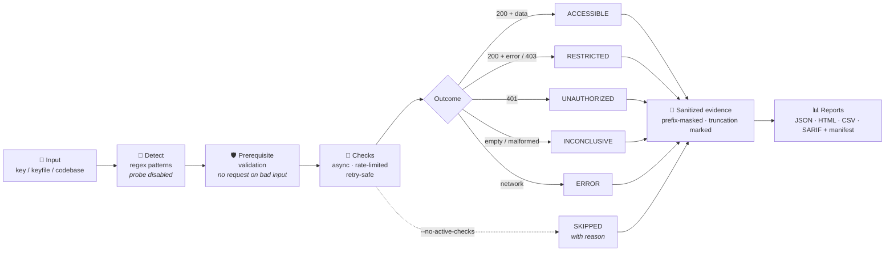

<div align="center">

# 🔐 apiKeyScan — Universal API Security Recon

**Async multi-provider API key security reconnaissance.**
Find out what an exposed key can *actually* do: exfiltrate data, burn billing quota,
manipulate auth services, or move laterally through cloud infrastructure.

[](https://github.com/qyzan/apikeyScan/actions/workflows/ci.yml)


[Features](#-features) · [Quick start](#-quick-start) · [How it works](#-how-it-works) · [Safety](#%EF%B8%8F-safety--consent) · [CLI](#-cli-reference) · [Exit codes](#-exit-codes-cicd)

</div>

---

## ✨ Features

| | Capability | Detail |
|---|---|---|
| 🌐 | **14 providers** | Google Cloud, Azure, OpenAI, AWS, GitHub, Anthropic, HuggingFace, Stripe, Twilio, Slack, Discord, SendGrid, GitLab, DigitalOcean |
| ⚡ | **Async & concurrent** | `asyncio` + `aiohttp`, bounded concurrency and request rate as *separate* limits |
| 🏷️ | **Honest outcomes** | `ACCESSIBLE / RESTRICTED / UNAUTHORIZED / NOT_FOUND / BAD_REQUEST / INCONCLUSIVE / ERROR / SKIPPED` — 200 alone is never called a confirmed vulnerability |
| 📊 | **5 report formats** | Console, JSON, HTML dashboard, CSV, SARIF 2.1.0 (GitHub Code Scanning ready) |
| 🔍 | **Key auto-detection** | Regex-based provider identification (probe-based detection disabled for safety) |
| 🧩 | **Plugin auto-discovery** | Drop a new `scanners/<provider>_scanner.py` in — it loads itself |
| 🔒 | **Credential masking** | Prefix-only masking everywhere (console, reports, filenames) — suffixes never shown |
| 🗄️ | **Encrypted vault** | Optional per-run AES-256-GCM credential vault with operator-only ACL |
| 📦 | **Batch + extract** | Multi-key scans with manifest reconciliation, and codebase key extraction |
| 🔔 | **Notifications** | Slack & Discord webhooks with structured delivery outcomes, redacted URLs |

> [!IMPORTANT]
> **Breaking change (B04, Nov 2026):** `status_text` values changed — `"VULNERABLE"` → `"ACCESSIBLE"`,
> network error severity `CRITICAL` → `ERROR`. Reports and notifiers use the `outcome` field as the
> machine contract. Active checks run **by default**; use `--no-active-checks` to disable.

---

## 🚀 Quick start

Requires **Python 3.10+**.

```bash
# install
pip install -e .

# scan a single key (provider auto-detected)
python apiKeyScan.py scan -k AIzaSy...

# explicit provider + all report formats
python apiKeyScan.py scan -p github -k ghp_xxxx --all-formats

# batch scan from a keyfile
python apiKeyScan.py scan --keyfile keys.txt --html --sarif

# extract leaked keys from a codebase
python apiKeyScan.py extract ./repo/
```

<details>
<summary><b>▸ More examples</b> (AWS pair, notifications, config presets, vault)</summary>

```bash
# AWS requires the secret pair
python apiKeyScan.py scan -p aws -k AKIAXXXXXX --secret YYYYYYYY --all-formats

# notifications
python apiKeyScan.py scan -p stripe -k sk_live_... --notify-slack $URL

# YAML config preset
python apiKeyScan.py scan --config preset.yaml

# encrypted credential vault (interactive terminal only)
python apiKeyScan.py scan -p google -k AIzaSy... --vault-dir ./vaults

# open a stored vault (no provider contact)
python apiKeyScan.py vault-open <vault.akv>

# list available checks
python apiKeyScan.py list-checks --provider google
```

</details>

---

## 🧭 How it works



Every execution ends in exactly one recorded outcome per check — `planned = completed + failed + skipped`,
reconciled in the batch manifest. Evidence is sanitized *before* it touches any output path.

---

## 🛡️ Safety & consent

> **Kapan:** sebelum scan dengan credential · **Siapa:** operator.

- **Active checks run by default.** This tool exists to *validate* capabilities, not merely list them.
  Mutating/billable checks (account creation, message/push send, generation, mail send) execute when
  credentials are provided — that is the point. Use `--no-active-checks` to disable them; they are
  recorded as `SKIPPED` with an explicit reason, never silently dropped.
- `--active-checks` remains accepted as a **no-op** for backward compatibility.
- `--force-probe` is **deprecated and rejected** (exit code 2) — probe-based provider detection sends
  credentials to provider endpoints and stays disabled. Specify the provider with `-p` instead.
- Rate limiting is enforced **per attempt, including retries**. POST (non-idempotent) is never retried
  after an ambiguous result like a timeout.

> [!WARNING]
> Running scans with real keys creates real effects: accounts may be created, messages sent, and
> billing consumed. Scan only keys you are authorized to test.

---

## 🗄️ Credential masking & encrypted vault

> **Kapan:** sebelum scan yang sudah diotorisasi · **Siapa:** operator.

**Masking.** Keys and tokens ≥ 16 characters show as their first 8 characters + `....`;
shorter values, passwords and Basic credentials are hidden completely. No suffix is ever shown.
Hosts, paths, field names, statuses and reasons stay readable. This is not a PII filter.

> **Kapan:** otomatis sebelum deteksi/probe/scan dalam mode vault · **Siapa:** runtime.

**Vault.** Opt in with `--vault-dir <existing-parent>` to store the run's credentials in a single
encrypted `.akv` file (AES-256-GCM, scrypt N=131072/r=8/p=1, random salt+nonce per checkpoint,
16 MiB cap). The password is generated per run, shown **once** on the controlling terminal, and
saved by you in a separate password manager. Without a controlling terminal or operator-only ACL
the vault fails closed. Reports carry opaque `vault_run`/`vault_record` references only.

> **Kapan:** saat operator perlu membuka hasil tersimpan · **Siapa:** operator.

Open locally with `python apiKeyScan.py vault-open <vault.akv>` — no-echo password input, output only
to the controlling terminal, zero provider contact. A lost password cannot be recovered; keep backups
and passwords separately.

---

## 🎛️ CLI reference

> **Kapan:** saat konfigurasi scan · **Siapa:** operator.

| Option | Description |
|--------|-------------|
| `--no-active-checks` | Disable mutating/billable checks; recorded as SKIPPED with reason |
| `--no-color` | Strip ANSI from every output path |
| `--quiet` | Suppress routine output (scan errors and exit codes still reported) |
| `--verbose` | Show URL and reason per result |
| `--severity-filter ERROR` | Display-only filter — full results are always stored |
| `--overwrite` | Overwrite existing report files (default: refuse) |
| `--concurrency N` | Max concurrent checks |
| `--connect-timeout S` / `--read-timeout S` | Transport timeouts in seconds |
| `--account-sid SID` | Twilio account SID (identifier, not a secret) |
| `--config FILE` | YAML preset — precedence: defaults < config < explicit CLI flags |
| `--vault-dir DIR` | Enable the encrypted credential vault |

---

## 🚦 Exit codes (CI/CD)

| Code | `scan` | `extract` |
|------|--------|-----------|
| ✅ `0` | Completed — no accessible findings, no errors | No candidates found (inspection completeness message shown) |
| 🟡 `1` | At least one `ACCESSIBLE` finding | Candidate keys found |
| 🔴 `2` | Error: input, scan failure, partial failure, all-unauthorized | Inspection failure or `--scan` rejected |

> [!NOTE]
> A scan where **zero** checks executed, all requests failed, or every result is `UNAUTHORIZED`
> never reports clean — it exits `2`. Error wins over findings.

---

## 🏗️ Architecture

```text
apiKeyScan/
├── apiKeyScan.py               # async entry point · subcommands scan/extract/list-checks/vault-open
├── core/
│   ├── base_scanner.py         # BaseScanner · ScanResult outcome contract · evidence pipeline
│   ├── config.py               # YAML schema + validation · default < config < CLI precedence
│   ├── key_detector.py         # regex detection (offline) + safe key extraction
│   ├── notifier.py             # Slack/Discord · structured NotificationResult · redacted URLs
│   ├── plugin_loader.py        # dynamic scanner discovery · failures surfaced, never silent
│   ├── redaction.py            # shared sanitizer · prefix masking · cookie/session aliases
│   ├── report_engine.py        # console + JSON/HTML/CSV/SARIF + batch manifest
│   ├── transport.py            # rate limiter · retry/backoff · Retry-After handling
│   └── vault.py                # encrypted per-run credential vault (AES-256-GCM)
└── scanners/                   # 14 providers — google 24 checks · openai 9 · aws 9 · github 9 · …
```

Adding a scanner: create `scanners/<provider>_scanner.py` inheriting `BaseScanner`, define
`PROVIDER_NAME` and `CHECKS`, implement `async def scan()`. The plugin loader finds it automatically.

---

## 🐳 Docker

> **Kapan:** saat eksekusi terisolasi via container · **Siapa:** operator.
> **Status:** Dockerfile dan Compose disediakan; build/runtime **belum dieksekusi** dalam sesi pengembangan ini — acceptance canary build dan verifikasi permission volume masih terbuka.

```bash
docker-compose run apikeyscan scan -p google -k AIzaSy...
```

`python:3.10-slim`, non-root user (UID 1000), read-only rootfs + tmpfs `/tmp`, reports to the named
volume `apikeyscan-reports`. Build context excludes credentials, reports, VCS and caches (`.dockerignore`).

---

## 🧪 Development

```bash
pytest                                          # 669 tests · network guard active by default
pytest --cov=core --cov=scanners --cov=apiKeyScan --cov-branch   # coverage (baseline 78%)
ruff check . && ruff format --check .           # lint + format (ruff==0.8.4, pinned)
mypy core/ scanners/ apiKeyScan.py              # types (mypy==2.4.0, pinned)
```

The test suite **cannot** reach the network: `tests/conftest.py` blocks non-loopback sockets and DNS
before collection, and `tests/test_network_guard.py` locks that guard in place. All fixtures are
synthetic — they are not evidence of current provider API behavior.

<details>
<summary><b>▸ Known limitations (open items)</b></summary>

- Docker build-context canary and Compose volume permission verification — requires a Docker-enabled session.
- Fully clean-room wheel install (no pre-existing deps) is not tested — network is blocked by design.
- 9 of 14 scanners have thin HTTP-path coverage (shared infrastructure is 88%+) — post-stabilization fixture work.
- CI matrix (3.10–3.13) is configured; older-interpreter runs are verified by the CI pipeline itself.

</details>

---

<div align="center">

**Educational and authorized security use only.** Scan only keys and systems you are permitted to test.

MIT License · Built with asyncio, aiohttp, and a stubborn respect for honest evidence.

</div>
